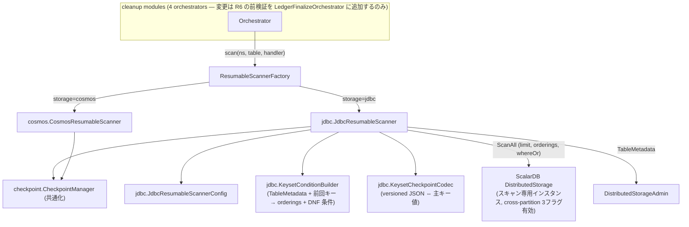
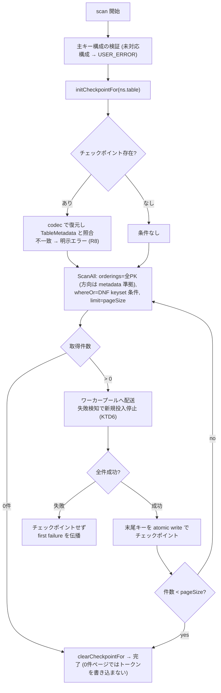

# JDBC Resumable Scan for scalardl-cleanup - 実装プラン

日付: 2026-08-21(2026-10-13 に実装に合わせて更新)
対象: scalardl-tools。ファイルパスはリポジトリルートからの相対パス。
関連: 設計根拠と EXPLAIN 実測は調査メモ [investigation.md](investigation.md) を参照。

**目的:** scalardl-cleanup の resumable scan を JDBC databases (RDBMS) に拡張し、4つの cleanup モジュールすべてを MySQL / PostgreSQL 等の ScalarDB JDBC storage 上で動作可能にする。セマンティクスは既存の Cosmos 実装に揃える。

---

## Product Contract

### Summary

`resumable-scan` モジュールに keyset ページネーション方式の `JdbcResumableScanner` を追加し、`ResumableScannerFactory` / `StorageValidator` で `jdbc` storage を許可する。チェックポイントは「最後に処理し終えたページ末尾の主キー値」を versioned JSON で永続化し、Cosmos 版と同じページ単位 at-least-once セマンティクスを実現する。MySQL / PostgreSQL の統合テスト・CI ジョブ・PostgreSQL での E2E・manifests の ConfigMap への JDBC 設定の案内までを含む。README の JDBC 対応は含まない(Deferred 参照)。

### Problem Frame

scalardl-cleanup の resumable scan は Cosmos DB の continuation token / FeedRange に依存しており、`StorageValidator` が `cosmos` 以外を拒否するため、実質 Cosmos DB 専用ツールになっている。ScalarDL の本番環境には RDBMS バックエンドが多く、cleanup ツールが使えない。RDBMS には continuation token 相当がないため、複数 RDBMS で共通に動く再開可能スキャンの仕組みが必要。

走査対象は ScalarDL 管理テーブルに限らない: ledger-finalize-records は、ScalarDL Functions の実行で coordinator を共有する**ユーザーの任意の ScalarDB ネームスペースの全トランザクショナルテーブル**を発見して走査する(`discoverTables()` は coordinator テーブル以外を除外しない)。したがって主キーのカラム数・型・clustering order にいかなる仮定も置けない。調査(2026-08-21)で、ScalarDB の cross-partition scan(`ScanAll` + `whereOr` + ordering + limit)によるキーセットページネーションが実現可能であり、生成される SQL が MySQL 8.4 / PostgreSQL 13・16 でインデックス効率の良いプランになることを EXPLAIN ANALYZE で実測済み。

### Requirements

**機能**

- R1. `scalar.db.storage=jdbc` の設定で 4つの cleanup モジュール(ledger-finalize-records / auditor-finalize-records / coordinator-state-cleanup / request-proof-cleanup)が動作する。`StorageValidator` と `ResumableScannerFactory` が `jdbc` を受け付ける。
- R2. `JdbcResumableScanner` は既存の `ResumableScanner` インターフェースを変更せずに実装し、テーブル全件を `RecordHandler` に配送する。
- R3. 同じ checkpoint dir で再実行すると最後に完了したページの直後から再開する。再配送は最大1ページ分(at-least-once)。ハンドラの冪等性は既存前提を踏襲。
- R4. 任意カラム数の主キー(partition keys + clustering keys)を扱える。ledger-finalize-records は ScalarDL Functions 用の任意のユーザーテーブルを走査するため、カラム数・型・clustering order に仮定を置かない。keyset 条件の比較演算子と ORDER BY の方向は `TableMetadata` の clustering order からカラム毎に導出する(DESC カラムは末尾の strict 比較を `>` → `<` に反転。全カラム一律 ASC を仮定すると、DESC 方向の物理 PK インデックスを持つテーブルでページ毎ソートが走り O(N²) に劣化する)。
- R5. ScalarDB がキーカラムに許す全型(BOOLEAN / INT / BIGINT / FLOAT / DOUBLE / TEXT / BLOB / DATE / TIME / TIMESTAMP / TIMESTAMPTZ)の keyset 条件構築とチェックポイント直列化をサポートする。BLOB は base64、時刻型は ISO-8601 文字列で型タグ付き直列化する。なお Db2 は BLOB キー自体を DB レベルで拒否する(`JDBC_DB2_INDEX_OR_KEY_ON_BLOB_COLUMN_NOT_SUPPORTED`)ため、Db2 上で BLOB キーのテーブルは存在し得ない。
- R6. ledger-finalize-records は `discoverTables()` 直後・state 永続化前に、全対象テーブルの主キー構成をスキャナがサポートすることを前検証し、万一未対応の構成があればスキャン開始前に USER_ERROR で失敗する(途中テーブルで初めて失敗し、完了済みマークとの組で再実行しても詰む事態を防ぐ防御線。R5 の全型サポートにより通常は常に通過する)。
- R7. ページ内の1件でもハンドラが失敗した場合、そのページはチェックポイントされない。最初の例外をそのまま伝播し、他は suppressed に添付する(`ResumableScanner` の javadoc 契約と Cosmos 実装のパリティ)。
- R8. チェックポイントと現テーブルの不整合(フォーマットバージョン不一致、PK カラム名・型の不一致、パース不能)は明示エラーで停止し、solution に「新しい checkpoint dir で再実行」を案内する。黙って0件スキャン成功にしない。
- R9. cross-partition scan の3フラグ(`scalar.db.cross_partition_scan.enabled` / `.filtering.enabled` / `.ordering.enabled`)はスキャン専用の Properties コピーにツールが設定する。ユーザーの properties ファイルに追加設定は不要。ユーザーが明示設定していた値を上書きする場合は INFO ログを出す。

**運用・テスト**

- R10. ページサイズとハンドラスレッド数を既存の設定規約(`scalar.dl.tools.scan.cosmos.*` と同型)で設定可能にする。
- R11. MySQL と PostgreSQL に対する統合テスト(モジュール毎の `jdbcIntegrationTest` Gradle タスク)と、GitHub Actions の CI ジョブ(Cosmos の直列チェーンとは独立に並列実行)を追加する。
- R12. E2E ワークフローに JDBC(PostgreSQL)版を追加し、`manifests/` の ConfigMap に JDBC で使う場合の設定方法をコメントで案内する。
- R13. Cosmos の既存動作は変更しない(既存の単体・統合テストがそのまま通る。チェックポイントのファイル名・配置の Cosmos 側互換を維持)。例外は U1 で共通パッケージへ移動する `CheckpointManagerTest` のみ — ケース内容無変更で、パッケージと API 名のみ追随する。

### Scope Boundaries

**Deferred to Follow-Up Work**

- `scalardl-cleanup/README.md` の JDBC 対応。現在の README は「Azure Cosmos DB for NoSQL のみサポート」と明記しており、JDBC 対応を正式に案内する段階で次を追記する: 対応ストレージへの JDBC の追加と検証済みバージョン(MySQL 8.4、PostgreSQL 13 / 16)、`scalar.db.storage=jdbc` 時の設定(`contact_points` は JDBC URL、`scalar.db.username` が必須)、`scalar.dl.tools.scan.jdbc.*` の設定項目、テーブル再作成後はチェックポイントを破棄する注意(KTD5)
- Oracle / SQL Server / Db2 / SQLite の統合テスト(ScalarDB が方言を吸収するため原理的には動作する。README には検証済みのエンジンとバージョンのみを記載する)
- スキャナのスレッド名がテーブル名の `%` で壊れる問題の修正(Cosmos 側にも同じ問題がある。[known-issues/scan-thread-name-format.md](../known-issues/scan-thread-name-format.md))
- 複合キーの「2クエリ方式」フォールバック最適化(境界パーティションを別クエリで消化する方式。KTD2 の DNF が特定エンジンで効かない場合のみ)
- 同一 checkpoint dir への二重起動ガード(lock ファイル)。Cosmos 版にも無いためパリティ扱い
- キーレンジ分割によるスキャン自体の並列化(FeedRange 相当)

**Outside this product's identity**

- Cosmos / JDBC 以外のストレージ(Cassandra, DynamoDB)対応
- ScalarDB 本体への変更

---

## Planning Contract

### Key Technical Decisions

- KTD1. **keyset ページネーション + ScalarDB 公開 API(`ScanAll`)** — ページ毎に `ScanAll`(全 PK カラムの orderings、keyset 条件、limit = pageSize)を発行し、取得件数 < pageSize で完了。生 JDBC(方言処理の自前実装が必要)、streaming cursor(長時間トランザクションのリスク)、OFFSET(削除中のズレ・深い OFFSET の遅さ)は却下。ScalarDB が SQL 方言を吸収するため、DB 非依存のコード1本で全 JDBC DB に対応できる。
- KTD2. **keyset 条件は DNF で組み `whereOr(Set<AndConditionSet>)` に渡す** — n カラムの主キーに対し、カラム毎に1つの disjunct を作る:
  ```
     (c1 >= v1 AND c1 > v1)
  OR (c1 >= v1 AND c1 = v1 AND c2 > v2)
  OR (c1 >= v1 AND c1 = v1 AND c2 = v2 AND c3 > v3)  …
  ```
  disjunct k は「先頭 k-1 カラムがチェックポイントと一致し、カラム k で先に進んでいる」レコードを拾うため、全体でチェックポイント以降のレコードをちょうど過不足なく選択する。
  - **先頭の `c1 >= v1` は全 disjunct に意図的に重複させる**: これが disjunct 間で字面上共有される唯一の下限であり、PostgreSQL がインデックススキャンの開始位置をチェックポイントに合わせる根拠になる。500,000行・3カラム PK での実測では、この冗長下限がある形は 26 buffers / 0.79ms、無い形は 5,372 buffers / 107ms(249,976行を破棄)。MySQL は各 disjunct から個別にタイトなレンジを導出する(`(a=v AND b=2 AND 5<c) OR (a=v AND 2<b) OR (v<a)` の3レンジ union)。
  - **CNF ではなく DNF で渡すことが本質的**: ScalarDB の `whereAnd`(CNF)は `SelectionBuilder.getConjunctions` が cartesian product で DNF 展開するため、disjunct 数が主キーカラム数に対して超指数的に増える(実測: 3カラム 6 disjunct / 17 パラメータ、5カラム 77 / 340、8カラム 4,082 / 28,168)。`whereOr` は展開を経ず素通しされるため線形に収まる(8カラムで 8 disjunct / 44 パラメータ)。両形式が同一の行集合を選ぶことは、ランダムな 200 件のチェックポイントで突き合わせて確認済み(不一致 0)。
  - **単一カラム主キー**は disjunct が1つなので共有下限が無意味になり、`c1 > v1` のみを出力する。
  - **DESC カラムの扱い(R4)**: prefix の等値条件は方向に依存しない。末尾の strict 比較のみ反転する(`>` → `<`)。ORDER BY はカラム毎に metadata の方向を使う。
- KTD3. **ページ単位チェックポイント(ハンドラ完了後に永続化)** — ページ全件の `RecordHandler` 処理が完了してから末尾レコードの主キーを atomic write で永続化する。再開時の再配送は最大1ページ。Cosmos 版(`CosmosScanWorker` のページ毎 continuation token 永続化)と同一セマンティクス。レコード単位のチェックポイントは却下(書き込み頻度と再配送量のバランスが取れ、Cosmos とセマンティクスが揃うため)。
- KTD4. **並列化は「スキャン1スレッド + ハンドラ側ワーカープール(ページバリア)」** — ページ取得は逐次、ページ内レコードの handler 呼び出しをスレッドプールに分配し、全件完了のバリア後にチェックポイントする。ボトルネックは handler 側の DB roundtrip(delete / put / recover)なのでこれで実効的な並列性が得られる。キーレンジ分割によるスキャン並列化は却下(RDBMS ではキー分布を知らずに汎用的なレンジ分割ができないため)。
- KTD5. **チェックポイント形式は versioned JSON(フォーマットバージョン + PK カラム名/型 + 型タグ付き値)** — 再開時に現 `TableMetadata` と照合し、不一致は R8 のとおり明示エラー。Cosmos では continuation token がサーバ側で無効化されて守られていた性質のうち、スキーマ変更・別テーブルへの流用・破損をクライアント側の検証で担保する。ただし**同一スキーマでのテーブル再作成**(schema-loader 再実行、バックアップリストア)は名前/型照合では検出できないため、運用で「テーブルを作り直した後は新しい checkpoint dir で実行する」必要がある(失敗方向は削除漏れ側で安全)。この注意は README の JDBC 対応時に記載する(Deferred 参照)。BIGINT は型タグ付きで直列化し Jackson の double 経路による 2^53 超の精度劣化を避ける。BLOB は base64、時刻型は ISO-8601 で直列化する(R5)。
- KTD6. **ワーカープールの失敗契約** — ページ内で失敗を検知したら新規ディスパッチを停止し in-flight のみ待つ。最初の失敗をそのまま伝播(`Error` は `Error` として)、残りは suppressed。scan スレッドの割り込みは interrupt フラグ復元 + プール cancel。`CosmosResumableScanner` の failure collection(first failure + suppressed)と同じ形。
- KTD7. **スキャン専用 storage / admin インスタンス** — Cosmos 版が自前 CosmosClient / admin を持つのと同様、`JdbcResumableScanner` はユーザー Properties のコピーに cross-partition 3フラグを立てた専用 `DistributedStorage` と `DistributedStorageAdmin` を生成・所有する。close 順: プール shutdown → storage → admin。コンストラクタ失敗時のクリーンアップも Cosmos パターン(`CosmosResumableScanner` のコンストラクタ)を踏襲。ページ毎の `Scanner` は try-with-resources で閉じる。ScalarDB 3.19 では `cross_partition_scan.enabled` のデフォルトは true、filtering / ordering は false。
  - **専用インスタンスのコネクションプールは上限 4 に絞る** — ScalarDB の JDBC プールのデフォルト(storage: min idle 20 / max total 200、metadata・admin: 各 5 / 25)をそのまま継承すると、スキャンは1スレッドで1ページずつしかクエリしないのに大量の接続を張り、呼び出し側が持つプールと合わせて DB の接続上限を使い切る(ledger-finalize-records の複数テーブル実行で PostgreSQL の接続が枯渇したことを統合テストで確認)。上限はユーザー設定値を下げる方向にのみ適用し、それより小さい設定値はそのまま使う。
- KTD8. **CheckpointManager は API を汎用化して共通パッケージへ移動** — `loadContinuationToken(table, rangeId)` 相当を汎用のトークン load / persist API とし、Cosmos は従来どおり feedRangeId、JDBC は固定 ID(例: `keyset`)で利用する。`.token` / `feed_ranges.json` のファイル名・テーブル別サブディレクトリ・`initCheckpointFor` / `clearCheckpointFor` のライフサイクルは維持(Cosmos 統合テストがファイル名を直接アサートしているため互換必須)。チェックポイントのキーは qualified table name(`namespace.table`)— auditor は複数名前空間で同名 `asset_lock` をスキャンするため必須。
- KTD9. **JDBC の CI / E2E は別ワークフローファイルに分離し、DB コンテナは CI レイヤーで供給する** — `concurrency: group: cosmos` は ci.yaml / e2e.yaml の workflow レベルにあり、GitHub Actions には workflow レベルの concurrency group からジョブ単位で抜ける手段がないため、同一ファイル内に JDBC ジョブを足す限り PR 間で直列化されてしまう。JDBC の CI / E2E は concurrency 指定なしの新規ワークフロー(`ci-jdbc.yaml` / `e2e-jdbc.yaml`)に置き、既存2ファイルは無変更のまま残す(R13 と整合)。CI のイメージタグは実測済みバージョン(`mysql:8.4`、`postgres:16`)に固定する。リポジトリに testcontainers の前例が無いため、Gradle テストはシステムプロパティで接続先を受け取る既存方式(`scalardb.*` sysprops 転送)を踏襲する。
- KTD10. **設定キーは `scalar.dl.tools.scan.jdbc.page_size`(デフォルト 1000)/ `scalar.dl.tools.scan.jdbc.max_handler_threads`(デフォルト 32)** — `CosmosResumableScannerConfig` の規約(ScalarDB properties ファイルに同居、正整数バリデーション、同型のエラーメッセージ)を踏襲。

### Assumptions

- FLOAT / DOUBLE キーの NaN / Infinity 値は型タグ付き直列化で表現できるが、DB 側の NaN の順序付けはエンジン依存のため、統合テストでは有限値のみを検証対象とする。
- (解消済みの前提)JDBC ドライバの追加依存は不要 — ScalarDB 3.19.0 の POM が `org.postgresql:postgresql` と `org.mariadb.jdbc:mariadb-java-client`(MySQL 接続にも使用、`permitMysqlScheme`)を runtime scope で同梱していることを確認済み。

### PR 構成

4本の stacked PR に分割する。

| PR | 内容 | ベース |
|---|---|---|
| PR1 | U1(CheckpointManager 共通化 — 純リファクタ、Cosmos 回帰レビューに集中) | master |
| PR2 | U2 + U3(codec / KeysetConditionBuilder / config — 配線なしの純ロジック + 単体テスト。DNF 一般形・DESC 反転・共有下限の不変条件の集中レビュー対象) | PR1 |
| PR3 | U4 + U5 + `jdbc` 有効化(validator / factory)— マージで JDBC が使えるようになる PR。resumable-scan の `jdbcIntegrationTest` タスクを含む(CI ワークフローは PR4) | PR2 |
| PR4 | U6 + U7(`ci-jdbc.yaml`、5モジュールの `jdbcIntegrationTest`)+ U8(E2E / manifests の ConfigMap)+ 本ドキュメント | PR3 |

### High-Level Technical Design

コンポーネント構成(新規は `scalardl-cleanup/resumable-scan/src/main/java/com/scalar/dl/tools/scan/` 配下):



ページループの状態遷移(方向性の指針であり実装仕様ではない):



### Sources & Research

- 調査メモ [investigation.md](investigation.md) — 設計方針の全根拠。MySQL 8.4 / PostgreSQL 13・16 での 50万行テーブルに対する EXPLAIN ANALYZE 実測(形 A/B/C の比較)を含む。
- ScalarDB 3.19 API の裏取り済み事実: `ScanBuilder.BuildableScanAll` に `whereOr(Set<AndConditionSet>)` / `whereAnd(Set<OrConditionSet>)` / `ordering` / `limit` あり。`SelectionBuilder.getConjunctions` は `whereOr` 経由の条件をそのまま通し、`whereAnd` 経由の CNF のみ cartesian product で DNF 展開する(簡約も上限も無し)。`OperationChecker.checkOrderingsForScanAll` は ScanAll の ordering カラムに存在チェックのみ(任意カラム・任意方向可 — R4 の DESC 対応が API 上可能な根拠)。JDBC の `SimpleSelectQuery` が DNF WHERE + ORDER BY + LIMIT を生成。
- JDBC ドライバ: ScalarDB 3.19.0 の POM は `org.postgresql:postgresql` / `org.mariadb.jdbc:mariadb-java-client`(MySQL 接続に使用)/ ojdbc8 / mssql-jdbc / sqlite-jdbc を runtime scope で同梱(ローカル Gradle キャッシュの POM で確認済み)→ ドライバ依存の追加は不要。
- BLOB キーの制約: Db2 のみ BLOB のキー利用自体を拒否(`CoreError.JDBC_DB2_INDEX_OR_KEY_ON_BLOB_COLUMN_NOT_SUPPORTED`)。他エンジンでは BLOB キーが作成可能なため R5 でサポートする。
- 既存パターンの所在: スキャナ実装 `scalardl-cleanup/resumable-scan/src/main/java/com/scalar/dl/tools/scan/cosmos/CosmosResumableScanner.java`(admin 所有・failure collection・close 順)、設定規約 `CosmosResumableScannerConfig.java`、テーブル発見 `scalardl-cleanup/ledger-finalize-records/src/main/java/com/scalar/dl/tools/cleanup/LedgerFinalizeOrchestrator.java`(`discoverTables`)。
- MySQL の case-insensitive collation でも PK 一意性制約により照合上等価な別キーは共存できず、keyset の取りこぼしは起きない(調査メモ「リスクと対処」)。

### Risks & Dependencies

- **DNF プッシュダウンの実行計画はエンジン依存** — MySQL / PostgreSQL は実測済みだが他エンジンは未検証。正しさは SQL 意味論で保証されるため機能は劣化しない(性能のみ)。README の JDBC 対応時に検証済みエンジンを明記し、2クエリ方式フォールバックを follow-up に残す。
- **CheckpointManager 共通化による Cosmos 回帰** — Cosmos 統合テストが `.token` / `feed_ranges.json` のファイル名を直接アサートしている。移動はファイル互換・API 互換を保ち、Cosmos 側の単体・統合テストを変更せずに通すことを回帰基準とする(R13)。
- **E2E の行数検証が CosmosDBShell 固有** — PostgreSQL 版は psql での件数取得と認証情報の配管が別経路になる。非 Java 部分で最大の作業(U8 で `STORAGE` による分岐として対応)。
- **MySQL 接続は MariaDB Connector/J 経由**(ScalarDB の `RdbEngineMysql` が使用)のため、MySQL 8.4 固有機能との差異は ScalarDB 側の吸収に依存する。U5 の MySQL 統合テストが実質の検証になる。
- **共有下限が失われると無音で性能劣化する** — 将来の ScalarDB が `c1 >= v1 AND c1 > v1` を簡約すると、PostgreSQL がインデックス開始位置を使えなくなり全体が O(N²) 化する(機能テストでは検出不能)。U3 に `ScanAll.getConjunctions()` を検査する回帰テストを置いて防ぐ。

---

## Implementation Units

Phase 1(コア実装): U1 / U2 / U3(相互に並行可)→ U4。Phase 2(テスト): U5 / U6(並行可)。Phase 3(CI / E2E / docs): U7(U5・U6 の後)と U8(U4 の後)は並行可。

### U1. CheckpointManager の共通化

- **Goal:** `CheckpointManager` を cosmos パッケージから共通パッケージへ移し、Cosmos / JDBC 双方から使える汎用トークン API にする。
- **Requirements:** R13(Cosmos 互換)、KTD8
- **Dependencies:** なし
- **Files:** `scalardl-cleanup/resumable-scan/src/main/java/com/scalar/dl/tools/scan/checkpoint/CheckpointManager.java`(移動元 `.../scan/cosmos/CheckpointManager.java`)、`scalardl-cleanup/resumable-scan/src/test/java/com/scalar/dl/tools/scan/checkpoint/CheckpointManagerTest.java`(移動)、`.../scan/cosmos/CosmosResumableScanner.java` / `CosmosScanWorker.java`(import 更新)
- **Approach:** `loadContinuationToken` / `persistContinuationToken` を汎用名(例: `loadToken(table, id)` / `persistToken(table, id, value)`)にし、Cosmos は feedRangeId、JDBC は固定 ID を渡す。`feed_ranges.json` の load / persist、`initCheckpointFor` / `clearCheckpointFor`、`FileUtils.writeAtomic` 利用、テーブル別サブディレクトリはそのまま。ファイル名・レイアウトは一切変えない。
- **Patterns to follow:** 既存 `CheckpointManager` のスレッド安全性コメントと javadoc スタイル。
- **Test scenarios:** 既存 `CheckpointManagerTest` の全ケースを移動後も無変更で通す(リネームした API 名のみ追随)。追加: 同一テーブルに複数 ID のトークンが共存できる。
- **Verification:** `./gradlew :resumable-scan:check` が通り、Cosmos 側テストが無変更で green。

### U2. JdbcResumableScannerConfig とチェックポイント codec

- **Goal:** JDBC スキャナの設定クラスと、主キー値 ⇔ versioned JSON のチェックポイント codec を追加する。
- **Requirements:** R5、R8、R10、KTD5、KTD10
- **Dependencies:** なし(U1 と並行可)
- **Files:** `scalardl-cleanup/resumable-scan/src/main/java/com/scalar/dl/tools/scan/jdbc/JdbcResumableScannerConfig.java`、`.../scan/jdbc/KeysetCheckpointCodec.java`、対応する `src/test/java` のテスト2ファイル
- **Approach:**
  1. Config: `scalar.dl.tools.scan.jdbc.page_size`(default 1000)/ `.max_handler_threads`(default 32)。`CosmosResumableScannerConfig` の `getPositiveIntProperty` バリデーションとメッセージ様式を踏襲。
  2. Codec: フォーマットバージョン、PK カラム名と ScalarDB DataType、型タグ付き値を持つ JSON をエンコード / デコード。デコード時に現 `TableMetadata` の PK 定義と照合し、不一致・未知バージョン・パース不能は専用例外。**全 ScalarDB キー型**の値を往復できる(BIGINT は long 経路で精度維持、BLOB は base64、時刻型は ISO-8601)。
- **Patterns to follow:** `CosmosResumableScannerConfigTest` の AAA コメント・テスト命名(`method_condition_shouldOutcome`)。
- **Test scenarios:**
  - Config: デフォルト値 / カスタム値 / 非数値・0・負値で `IllegalArgumentException`
  - Codec: TEXT 単一キーの往復 / TEXT+INT 複合キーの往復 / BIGINT 境界値(`Long.MAX_VALUE`)の精度維持 / FLOAT・DOUBLE・BOOLEAN・BLOB・時刻型(DATE / TIME / TIMESTAMP / TIMESTAMPTZ)の往復 / カラム名不一致で例外 / 型不一致で例外 / バージョン不一致で例外 / 壊れた JSON で例外
- **Verification:** `./gradlew :resumable-scan:check` green。

### U3. KeysetConditionBuilder

- **Goal:** `TableMetadata` と前回キーから、ScanAll 用の orderings と DNF keyset 条件(`Set<AndConditionSet>`)を構築するビルダーを追加する。
- **Requirements:** R4、R5、KTD2
- **Dependencies:** なし(U1 / U2 と並行可)
- **Files:** `scalardl-cleanup/resumable-scan/src/main/java/com/scalar/dl/tools/scan/jdbc/KeysetConditionBuilder.java`、`src/test/java` のテスト
- **Approach:** PK カラム列は partition key names → clustering key names の順。orderings はカラム毎に `TableMetadata` の clustering order から導出する(partition key は ASC)。条件は KTD2 の DNF 一般形をカラム毎に1 disjunct ずつ構築し、`whereOr` に渡す。ConditionBuilder / ConditionSetBuilder の公開 API のみ使用し、全キー型(R5)の値を扱う。`ConditionBuilder.buildConditionalExpression(Column, Operator)` は javadoc で内部利用向け・破壊的変更ありと明記されているため使わず、型ごとの typed メソッドで組む。
- **Technical design(方向性の指針):** 2カラム `(id, age)` の出力 = orderings `[id ASC, age ASC]`、whereOr `[{id >= v, id > v}, {id >= v, id = v, age > a}]`。3カラム `(a, b, c)` の出力 = `[{a>=va, a>va}, {a>=va, a=va, b>vb}, {a>=va, a=va, b=vb, c>vc}]`。
- **Test scenarios:**
  - 単一 TEXT キー: 条件が `pk > last` の1 disjunct になる(共有下限を付けない)
  - TEXT+INT 複合キー: 2 disjunct で、2つ目が `{id >= v, id = v, age > a}` になる
  - 3カラムキー: 3 disjunct で、k 番目が「先頭 k-1 カラムの等値 + カラム k の strict」になることを値まで検証する
  - DESC clustering カラムを含むキー: 末尾の strict 比較のみ反転(`<`)し、prefix の等値と共有下限は不変、ordering が DESC になる
  - チェックポイントなし(初回): 条件なし・orderings のみ
  - 全 ScalarDB キー型(BLOB・時刻型含む)の値で条件が構築できる
  - 共有下限の不変条件: 構築した ScanAll の `getConjunctions()` の全 conjunction が先頭カラムの下限条件を含むことをアサートする(ScalarDB 側の変更で無音の性能劣化が起きた場合に検出する回帰テスト)
  - 線形性の回帰: 8カラム主キーで disjunct 数が 8、条件総数が O(n²) の上界内に収まることをアサートする(CNF 経路に戻ると 4,082 disjunct になるため検出できる)
- **Verification:** `./gradlew :resumable-scan:check` green。

### U4. JdbcResumableScanner 本体と factory / validator の jdbc 対応

- **Goal:** ページループ・ワーカープール・チェックポイント連携を実装し、`ResumableScannerFactory` / `StorageValidator` で jdbc を許可する。
- **Requirements:** R1、R2、R3、R5、R6、R7、R9、KTD1、KTD3、KTD4、KTD6、KTD7
- **Dependencies:** U1、U2、U3
- **Files:** `scalardl-cleanup/resumable-scan/src/main/java/com/scalar/dl/tools/scan/jdbc/JdbcResumableScanner.java`、`.../scan/ResumableScannerFactory.java`、`scalardl-cleanup/common/src/main/java/com/scalar/dl/tools/common/StorageValidator.java`、`.../common/ScalarDlCleanupError.java`(新エラー: 未対応キー型 `015`、チェックポイント不整合 `016`)、`scalardl-cleanup/ledger-finalize-records/src/main/java/com/scalar/dl/tools/cleanup/LedgerFinalizeOrchestrator.java`(発見直後の前検証)、テスト: `JdbcResumableScannerTest.java`、`ResumableScannerFactory` 相当のテスト、`StorageValidatorTest.java`("jdbc" を rejected リストから accepted へ移動)、`LedgerFinalizeOrchestratorTest.java`(前検証ケース追加)
- **Approach:**
  1. コンストラクタ: Properties コピーに cross-partition 3フラグを設定(ユーザー明示値の上書きは INFO ログ、R9)し、専用 storage / admin を生成。失敗時クリーンアップは Cosmos パターン踏襲。
  2. `scan()`: 主キー構成の検証(未対応構成 → USER_ERROR)→ `initCheckpointFor` → チェックポイント復元・照合(U2 codec、失敗は R8 のエラー)→ ページループ(HTD の状態遷移図どおり)→ `clearCheckpointFor`。**各ページは全件をリストに取り切って `Scanner` を閉じてから**(try-with-resources)ワーカープールへ投入する — handler が同一テーブルを削除するため、開いたカーソルと削除の交差をエンジン依存にしない。
  3. ワーカープール: ページ毎にレコードを投入し、失敗検知で新規投入停止・in-flight 待ち・first failure 伝播(KTD6)。プールは scan 単位で生成し finally で shutdown(30秒 await は Cosmos と同値)。
  4. 前検証(R6): 検証機能は factory 経由(またはスキャナ実装クラスの公開メソッド)で公開し、`ResumableScanner` インターフェースは変更しない(R2)。`LedgerFinalizeOrchestrator` は `TOO_FEW_TARGET_TABLES` チェックと同じ場所(state 永続化前)で全対象テーブルを検証する。
  5. `ScanResult.totalScanned` は「この実行で配送した件数」(Cosmos パリティ)。
- **Patterns to follow:** `CosmosResumableScanner`(admin 所有、`ScalarDbUtils.getFullTableName`、failure collection、`@VisibleForTesting` コンストラクタ)、`CosmosScanWorkerTest` / `CosmosMockHelper` のモック様式。
- **Test scenarios:**
  - 空テーブル: 0件で完了、チェックポイント書き込みなし、`clearCheckpointFor` 呼び出し
  - 複数ページ(pageSize ちょうどの倍数を含む): 全件配送、最終 0 件ページで既存チェックポイントに触れない
  - 再開: チェックポイントありで keyset 条件付き ScanAll が発行され、続きから配送される
  - ハンドラ例外(ページ先頭 / 中間 / 複数件同時): 該当ページがチェックポイントされない、first failure がそのまま伝播、他が suppressed
  - 割り込み: interrupt フラグ復元、プール cancel
  - チェックポイント不整合(カラム名変更 / 型変更 / 壊れた JSON): R8 のエラーで停止
  - DESC clustering・複合キー(3カラム)・BLOB キーのテーブル: 正しい orderings / 条件で ScanAll が発行される
  - cross-partition フラグ: ユーザー未設定 → 設定される、ユーザーが false 明示 → 上書き + INFO ログ
  - factory: storage=jdbc で `JdbcResumableScanner`、cosmos で従来どおり、その他で更新済みメッセージの例外
  - StorageValidator: jdbc / cosmos 受理、cassandra / dynamo / multi-storage 拒否
  - LedgerFinalizeOrchestrator: 未対応の主キー構成のテーブルを含む場合、state 永続化前に USER_ERROR
- **Verification:** `./gradlew :resumable-scan:check :common:check :ledger-finalize-records:check` green。

### U5. resumable-scan の JDBC 統合テスト

- **Goal:** 実 MySQL / PostgreSQL に対して keyset SQL・ページ境界・再開の正しさを検証する統合テストと Gradle タスクを追加する。
- **Requirements:** R11、R13
- **Dependencies:** U4
- **Files:** `scalardl-cleanup/resumable-scan/src/integration-test/java/com/scalar/dl/tools/scan/jdbc/JdbcEnv.java`、`.../jdbc/JdbcResumableScannerIntegrationTest.java`、`scalardl-cleanup/resumable-scan/build.gradle`(`jdbcIntegrationTest` タスク。JDBC ドライバは ScalarDB が transitive に同梱するため追加依存不要 — Sources & Research 参照)
- **Approach:** `JdbcEnv` は `scalardb.jdbc.url` / `.username` / `.password` システムプロパティから `Properties` を構築(`CosmosEnv` のミラー。MySQL / PostgreSQL の違いは contact_points のみなので1クラスで両対応)。`jdbcIntegrationTest` タスクは `cosmosIntegrationTest` と同じ雛形(`scalardb` sysprops 転送、`outputs.upToDateWhen { false }`)。ScalarDB Admin でテーブル作成 → データ投入 → シナリオ実行。
- **Execution note:** ローカルでは Docker で MySQL / PostgreSQL を起動して実行し、スキャン結果の網羅性(全レコードちょうど1回以上、欠落ゼロ)をアサートすること。
- **Test scenarios:**
  - フルスキャン(TEXT 単一キー、pageSize より大きい件数): 全件配送
  - TEXT+INT 複合キーテーブル(asset 相当): 全件配送、ページ境界がパーティション途中でも欠落なし
  - 3カラム複合キーテーブル: ページ境界が「先頭2カラムがチェックポイントと等しい行」を跨いでも欠落なし(KTD2 一般形の実 DB 検証)
  - DESC clustering order のテーブルおよび BLOB・時刻型キーのテーブル: 全件配送(R4 / R5 の実 DB 検証)
  - 中断 → 再開: N ページ目で例外を注入して失敗させ、再実行で全レコードが少なくとも1回配送される(at-least-once)、再配送は最大1ページ分
  - 空テーブル / pageSize ちょうどの倍数
  - チェックポイント破損: 明示エラー
  - スキャン中のレコード削除(handler が自テーブルを削除): 欠落なし
- **Verification:** `./gradlew :resumable-scan:jdbcIntegrationTest -Dscalardb.jdbc.url=... -Dscalardb.jdbc.username=... -Dscalardb.jdbc.password=...` が MySQL / PostgreSQL 両方で green。

### U6. cleanup モジュールの JDBC 統合テスト

- **Goal:** 4つの cleanup モジュールの既存 `*IntegrationTestBase` に JDBC サブクラスを追加する。
- **Requirements:** R1、R11
- **Dependencies:** U4(U5 と並行可)
- **Files:** 各モジュールの `src/integration-test/java/com/scalar/dl/tools/cleanup/jdbc/JdbcEnv.java` と `Jdbc<Xxx>IntegrationTest.java`(ledger-finalize-records / auditor-finalize-records / coordinator-state-cleanup / request-proof-cleanup)、各モジュールの `build.gradle`(`jdbcIntegrationTest` タスク)
- **Approach:** 既存ベースクラスは storage 非依存(純 ScalarDB API)なので、`CosmosLedgerFinalizeOrchestratorIntegrationTest`(13行)と同型の薄いサブクラス + `JdbcEnv` を各モジュールに置くだけ。MySQL / PostgreSQL は接続先プロパティの切り替えで両対応。
- **Test scenarios:** ベースクラスの既存シナリオを JDBC 上でそのまま実行(新規シナリオは追加しない)。
- **Verification:** 各モジュールの `jdbcIntegrationTest` が MySQL / PostgreSQL で green。

### U7. CI ワークフローへの JDBC ジョブ追加

- **Goal:** GitHub Actions に MySQL / PostgreSQL の統合テストジョブを追加する。
- **Requirements:** R11、KTD9
- **Dependencies:** U5、U6
- **Files:** `.github/workflows/ci-jdbc.yaml`(新規。`ci.yaml` は無変更)
- **Approach:** `concurrency` 指定なしの新規ワークフローに PostgreSQL / MySQL の2ジョブを置き、5モジュールの `jdbcIntegrationTest` を実行。既存 `ci.yaml` は workflow レベルの `concurrency: group: cosmos` を持つため同一ファイル内ではジョブ単位の除外ができない(KTD9)。イメージタグは実測済みバージョンに固定(`mysql:8.4`、`postgres:16`)。トリガ(paths 等)は `ci.yaml` に合わせる。シークレット不要(コンテナのローカル認証情報)。
  - **DB コンテナは service container ではなく `docker run` で起動し、`max_connections` を 400 に上げる。** 統合テストは同時に複数の ScalarDB インスタンスを開き、それぞれがプールを eager に確保する(storage プールだけで idle 20 本)ため、PostgreSQL のデフォルト上限 100 に対してピーク 98 本と余裕がなかった。サーバ引数は service container では渡せない。
- **Test scenarios:** Test expectation: none — CI 設定のため。動作確認は PR 上の実行結果で行う。
- **Verification:** PR の CI で JDBC ワークフローが green、既存 Cosmos ワークフロー(`ci.yaml` / `e2e.yaml`)が diff に含まれない。

### U8. E2E / manifests の JDBC 版

- **Goal:** PostgreSQL バックエンドの E2E を追加し、manifests の ConfigMap に JDBC で使う場合の設定方法を案内する。
- **Requirements:** R12
- **Dependencies:** U4(U7 と並行可 — U8 が必要とするのは動作する JDBC スキャナのみで、U7 の成果物は消費しない)
- **Files:**
  - `.github/workflows/e2e-jdbc.yaml`(新規。`e2e.yaml` は workflow レベル concurrency のため無変更 — KTD9)
  - `scalardl-cleanup/ci/e2e/common.sh`(`STORAGE=cosmos|jdbc` から接続先・認証情報を解決。デフォルトは `cosmos`)
  - `scalardl-cleanup/ci/e2e/postgres.yaml`(新規。Ledger の namespace に PostgreSQL 16 をデプロイ)
  - `ledger.yaml` / `auditor.yaml` / `schema-loader.yaml` / `scalardb-cluster.yaml`(storage・接続先・username をパラメータ化)と `manage-cluster.sh`(SUBST_VARS、jdbc 時の PostgreSQL デプロイ)
  - `cleanup-jobs.sh`(ConfigMap の描画と件数カウント)、`db-records.sh`(fixture の件数検証)、`setup-fixture.sh`、`scenarios/happy-path.sh` / `scenarios/interrupt-resume.sh`
  - `scalardl-cleanup/manifests/{ledger-ad,auditor-ad}/configmap.yaml`(JDBC で使う場合の設定方法のコメントと、コメントアウトした `scalar.db.username` 行)
  - `JdbcResumableScanner.java`(最初のチェックポイント保存時のログ。下記 interrupt-resume 参照)
- **Approach:**
  - PostgreSQL は minikube 内にデプロイするため、ワークフローは DB の認証情報を持たない。Ledger / Auditor の両 AD が同じ PostgreSQL を使う。
  - cleanup Job の ConfigMap は引き続き同梱の manifests から描画する。jdbc 時は `scalar.db.storage=cosmos` を `jdbc` に切り替え、`scalar.db.username` 行のコメントを外す(運用者が適用するものをそのまま検証するため)。
  - 件数カウント(`count_records` / `count_unsettled_records` / `count_held_locks` 等)は `STORAGE` で分岐し、jdbc では PostgreSQL の Pod 内で psql を実行する。Cosmos 経路のクエリは無変更。
  - interrupt-resume は storage ごとに中断・再開のマーカーを持つ。JDBC スキャンは最初のページをチェックポイントするまで再開可能な状態を持たないため、スキャナが一度だけ出す `Saved the first scan checkpoint for <table>` を中断の合図にし、再開側は `Resuming the scan of <table> from the persisted keyset checkpoint` で確認する。
  - JDBC スキャンは1ページ1行でも数ミリ秒で終わり、また `--force` で削除した Pod はしばらく動き続けて実行を完了させてしまうことがある。そのため jdbc 時の interrupt-resume は、走査する各テーブル(`e2e_db.records` / `auditor.asset_lock` / `coordinator.state`)に処理不要な行を 5000 行ずつ、処理対象の行より前に並ぶキーで追加してから中断する。
  - README の更新はこの PR に含めない(Deferred 参照)。
- **Execution note:** 非 Java 部分で最大の作業。E2E スクリプトの分岐は既存 Cosmos 経路への回帰が無いこと(`STORAGE` 未指定時に描画結果・マーカー・クエリが従来と同一)を確認する。
- **Test scenarios:** Test expectation: none — E2E 設定のため。E2E ワークフロー自体が検証。
- **Verification:** JDBC E2E ワークフローが green(デプロイ → old-auditor → happy-path → interrupt-resume → 後片付け)。interrupt-resume では3コマンドとも中断した実行を再開し、削除・残存件数が中断しない場合と一致する。

---

## Verification Contract

| ゲート | コマンド | 適用範囲 |
|---|---|---|
| 静的検査 + 単体テスト | `./gradlew check`(scalardl-cleanup 配下、spotless / spotbugs / errorprone 含む) | 全 unit |
| JDBC 統合テスト (MySQL) | `./gradlew :<module>:jdbcIntegrationTest -Dscalardb.jdbc.url=jdbc:mysql://... -Dscalardb.jdbc.username=... -Dscalardb.jdbc.password=...` | U5、U6 |
| JDBC 統合テスト (PostgreSQL) | 同上(url を jdbc:postgresql に変更) | U5、U6 |
| Cosmos 回帰 | 既存の単体テストが無変更で green(`check` に含まれる)。`cosmosIntegrationTest` は CI の Cosmos ジョブで確認 | U1、U4 |
| CI / E2E | PR 上で JDBC CI ワークフロー(`ci-jdbc.yaml`)と JDBC E2E ワークフロー(`e2e-jdbc.yaml`)が green。既存 `ci.yaml` / `e2e.yaml` は diff に含まれない | U7、U8 |

---

## Definition of Done

- R1〜R13 が満たされ、各 unit の Verification をすべて通過している。
- Cosmos の既存テスト(単体・統合)が無変更で green(R13。例外は U1 で移動する `CheckpointManagerTest` — ケース内容無変更、パッケージ・API 名のみ追随)。
- 実験的・不採用コードが diff に残っていない。
- PR が open され CI が green。
